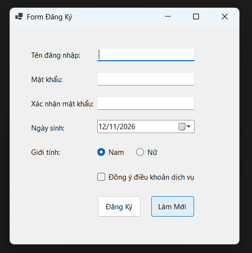
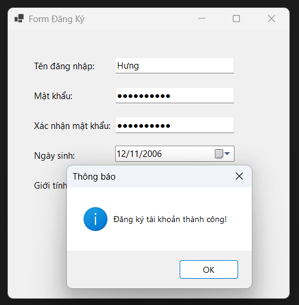
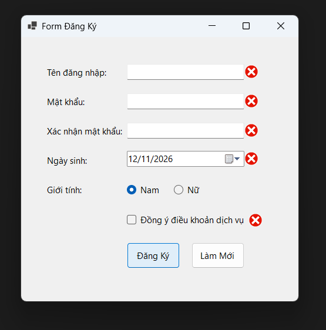
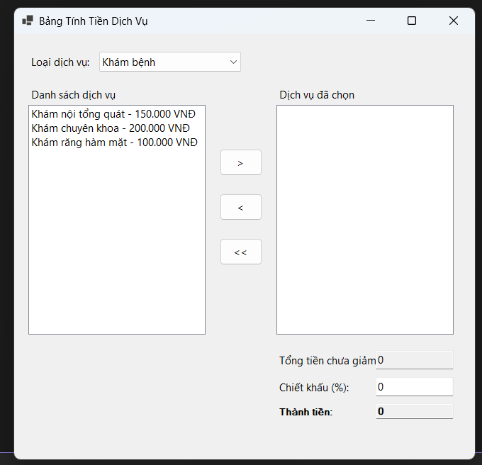
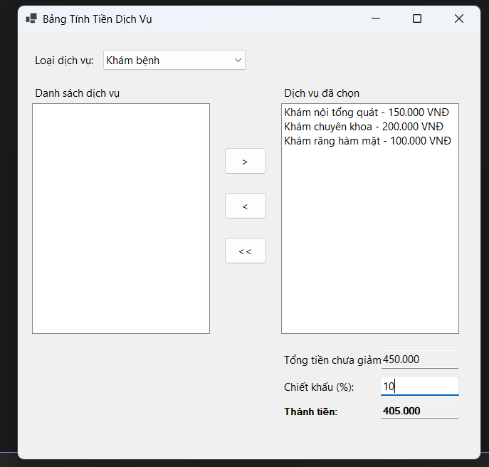
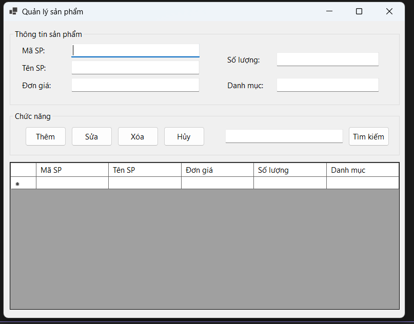
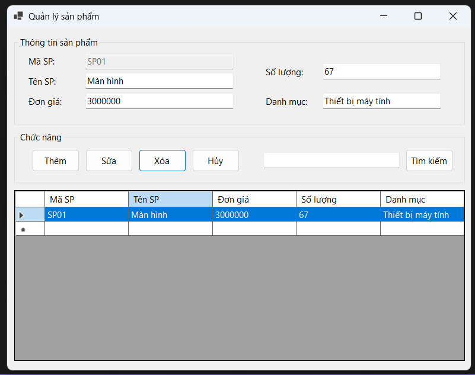
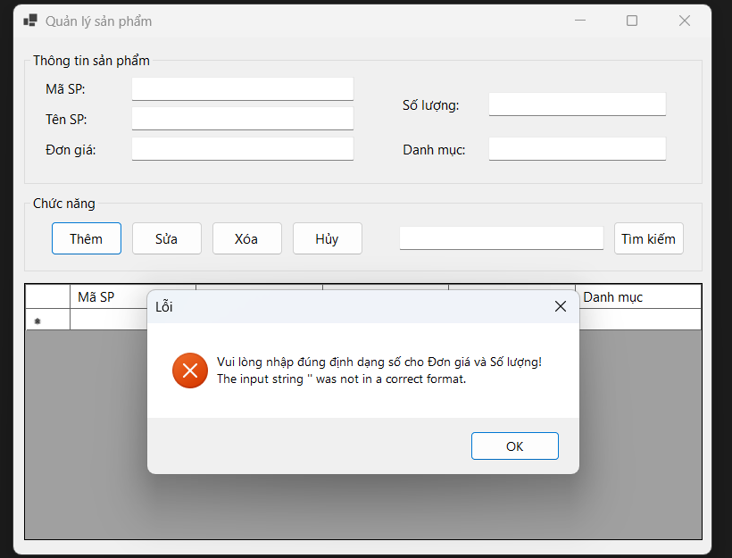
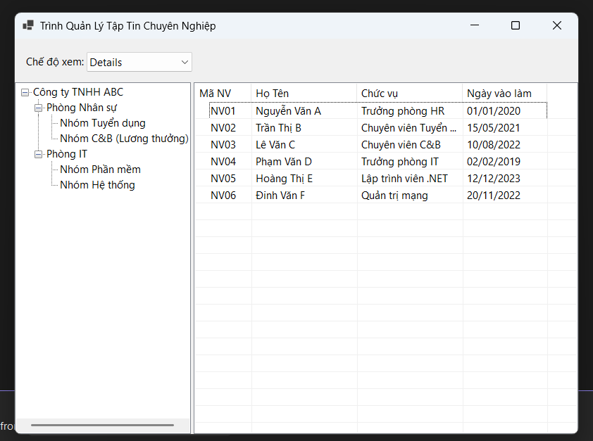
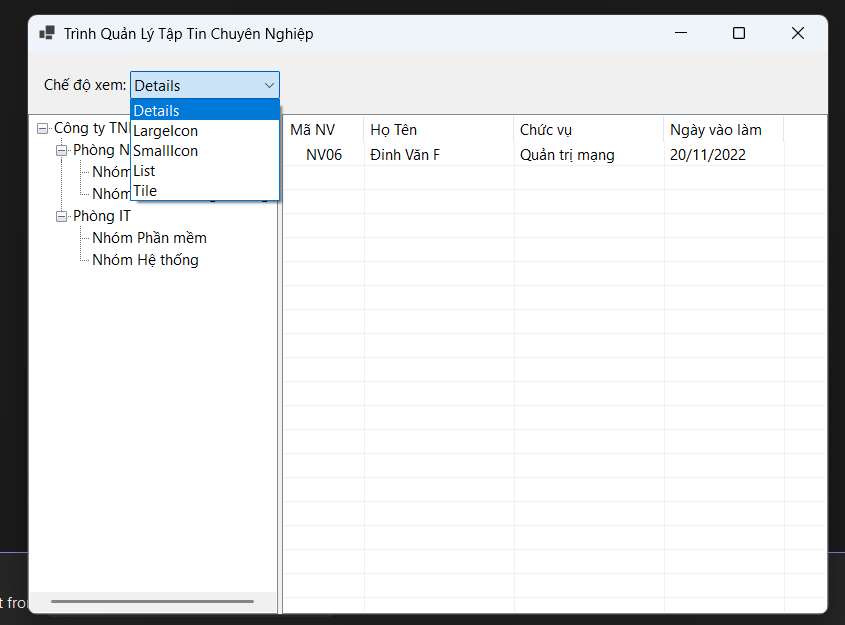

# BÁO CÁO BÀI TẬP

## THÔNG TIN SINH VIÊN
- **Họ và tên:** Phạm Hữu Hưng
- **Mã số sinh viên:** 24810310239
- **Lớp:** D19CNPM3
- **Tên môn học:** Lập trình .NET
- **Tên bài tập:** Bài thực hành .NET - 12/11/26

---

## KẾT QUẢ THỰC HÀNH

### BÀI 5.1: FORM ĐĂNG KÝ TÀI KHOẢN VÀ BẮT LỖI GIAO DIỆN(ERRORPROVIDER)

#### ẢNH GIAO DIỆN MÀN HÌNH CHÍNH

##### ẢNH MÀN HÌNH THỰC THI

---

#### ẢNH MÀN HÌNH KIỂM TRA LỖI

---

### BÀI 5.2: BẢNG TÍNH TIỀN DỊCH VỤ VÀ CHIẾT KHẤU ĐƠN HÀNG(LISTBOX & COMBOBOX)
#### ẢNH GIAO DIỆN MÀN HÌNH CHÍNH

##### ẢNH MÀN HÌNH THỰC THI

---

### BÀI 5.3: FORM QUẢN LÝ DANH SÁCH SẢN PHẨM TRONG BỘ NHỚ(DATAGRIDVIEW CƠ BẢN)
#### ẢNH GIAO DIỆN MÀN HÌNH CHÍNH

##### ẢNH MÀN HÌNH THỰC THI

---

##### ẢNH MÀN HÌNH THỰC THI KHI MUỐN XÓA THIẾT BỊ

.png>)

---
#### ẢNH MÀN HÌNH THỰC THI KHI TÌM KIẾM THEO TÊN SP

.png>)

---

#### ẢNH MÀN HÌNH KIỂM TRA LỖI

---

### BÀI 5.4: TRÌNH QUẢN LÝ TẬP TIN DẠNG CHUYÊN NGHIỆP(TREEVIEW & LISTVIEW)
#### ẢNH GIAO DIỆN MÀN HÌNH CHÍNH

##### ẢNH MÀN HÌNH THỰC THI

---

